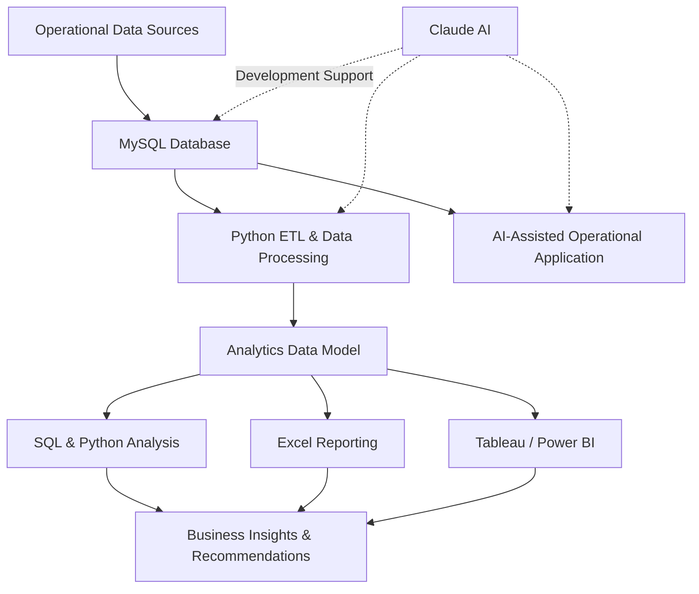

[<- Back to Projects](https://github.com/heesoo-kim97/portfolio-guide/blob/main/README.md)

# Paci Coast — Supply Chain & Business Operations Analytics System

**An AI-assisted supply chain analytics platform simulating the procurement, inventory, warehouse, transportation, and financial operations of a Southern California beverage distribution company.**

> How can data analytics, business intelligence, and AI-assisted development improve supply chain efficiency, operational performance, and financial decision-making?

**Status:** In Progress

## Project Navigation

| Section | Description |
|---|---|
| [Business Overview](#business-overview) | Company background, business model, and operational challenges |
| [Business Insights](#business-insights) | Key findings, KPIs, and business recommendations |
| [Dashboards](#dashboards) | Interactive analytics and visual reporting |
| [Business Case Studies](#business-case-studies) | Detailed analyses of operational business problems |
| [Data & Database](#data--database) | Data model, ERD, database structure, and datasets |
| [SQL Analysis](#sql-analysis) | Analytical queries and business metrics |
| [Python & ETL](#python--etl) | Data generation, transformation, cleaning, and validation |
| [AI-Assisted Development](#ai-assisted-development) | Claude usage, prompts, implementation, and validation |
| [Project Architecture](#project-architecture) | System architecture and technical workflow |
| [Project Roadmap](#project-roadmap) | Development progress and future enhancements |

---

## 1. Project Overview

Paci Coast Supply Chain & Business Operations Analytics is an end-to-end data analytics project simulating the operations of a medium-sized beverage distribution company in Southern California.

The project aims to develop a centralized analytical environment that connects procurement, supplier management, inventory, warehouse operations, customer orders, transportation, and financial performance.

Using SQL, Python, Excel, and business intelligence tools, the system will transform operational and transactional data into actionable business insights.

The platform will focus on identifying operational inefficiencies, evaluating business performance, analyzing costs, and supporting data-driven management decisions.

Claude will be incorporated throughout development to assist with system design, database development, data engineering, application development, and quality assurance. AI-generated outputs will be reviewed and validated against defined business requirements.

### Project Objectives

- Develop a relational database representing an interconnected supply chain operation.
- Build repeatable data generation, extraction, transformation, and validation workflows.
- Analyze inventory, procurement, warehouse, transportation, and financial performance.
- Develop business intelligence dashboards and operational KPI reporting.
- Investigate business problems and provide data-driven recommendations.
- Demonstrate effective AI-assisted development using Claude.

---

## 2. Company Background

**Paci Coast Beverage Distribution**

| Business Attribute | Description |
| --- | --- |
| Industry | Beverage / Consumer Packaged Goods / Distribution |
| Headquarters | Southern California |
| Business Model | B2B Beverage Distribution |
| Company Size | Medium-sized |
| Primary Customers | Retailers, convenience stores, grocery stores, and food-service businesses |
| Primary User | Operations Manager |

### Business Profile

Paci Coast is a fictional Southern California beverage company that produces, stores, and distributes energy drinks to business customers across the region.

The company operates multiple distribution warehouses and manages relationships with suppliers, customers, and transportation providers.

As the business expands, management needs better visibility into inventory availability, procurement costs, warehouse efficiency, transportation performance, and overall financial results.

The analytics platform is designed to address these challenges through centralized operational data, financial reporting, and business intelligence.

| Operational Area | Initial Scope |
| --- | ---: |
| Warehouses | 3 |
| Employees | 75 |
| Product SKUs | 25+ |
| Customers | 15+ |
| Suppliers | 3–5 |
| Vehicles / Carriers | 8+ |
| Historical Data | 12 months |
| Distribution Region | Southern California |

---

## 3. Distribution Network

Paci Coast operates three regional distribution warehouses.

| Warehouse ID | Location | Primary Distribution Area |
| --- | --- | --- |
| WH-01 | Long Beach, CA | LA County / Coastal Region |
| WH-02 | Anaheim, CA | Orange County |
| WH-03 | Ontario, CA | Inland Empire |

Each warehouse maintains its own inventory, storage locations, receiving activities, and fulfillment operations.

The three-location network allows the project to analyze regional demand, inventory distribution, warehouse utilization, fulfillment performance, and transportation costs.

---

## 4. Product Portfolio

Paci Coast's product portfolio consists of eight beverage families with different flavors and packaging configurations.

### Product Families

| Product Family | Flavor |
| --- | --- |
| Pacific Original | Original |
| Pacific Zero | Zero Sugar |
| Pacific Citrus | Citrus Blast |
| Pacific Berry | Berry Rush |
| Pacific Tropical | Tropical |
| Pacific Watermelon | Watermelon |
| Pacific Grape | Grape |
| Pacific Peach | Peach |

### Packaging Formats

| Format | Description |
| --- | --- |
| Single Can | Individual 12 oz or 16 oz cans |
| 6-Pack | Six 12 oz cans |
| 12-Pack | Twelve 12 oz cans |
| Variety Pack | Assorted beverage flavors |

Each product and package configuration will receive a unique SKU to support inventory tracking, order processing, procurement, and demand analysis.

---

## 5. Business Operations & System Scope

The platform will simulate five interconnected business functions.

| Business Module | Scope |
| --- | --- |
| Inventory & Warehouse Management | Inventory levels, stock movements, warehouse utilization, transfers, and replenishment |
| Transportation & Fulfillment | Customer orders, picking, packing, shipments, delivery performance, and carrier management |
| Procurement & Supplier Management | Supplier information, purchase orders, purchasing costs, lead times, and supplier performance |
| Financial & Commercial Performance | Revenue, COGS, gross margin, operating expenses, and budget versus actual |
| Operational Performance & Improvement | KPI monitoring, exception analysis, operational bottlenecks, and improvement recommendations |

These modules will share a centralized operational database, allowing the analysis of relationships between business activities.

---

## 6. System Architecture

The platform will connect operational data, database management, data engineering, analytics, and business intelligence.

### Technology Stack

| Technology | Purpose |
| --- | --- |
| MySQL | Relational database and operational data management |
| SQL | Data extraction, transformation, querying, and analysis |
| Python | Synthetic data generation, ETL, data cleaning, and forecasting |
| Pandas / NumPy | Data manipulation and numerical analysis |
| Excel | Operational reporting, financial analysis, and scenario modeling |
| Tableau | Interactive business intelligence dashboards |
| Power BI | Data modeling, Power Query, DAX, and business reporting |
| Claude AI | AI-assisted development, data engineering, and testing |
| GitHub | Version control and project documentation |

---

## 7. Database & Analytics Architecture

The database will represent the company's operational transactions, while a separate analytical layer will support reporting and business intelligence.

### Operational Database

The operational database will contain interconnected relational tables covering:

| Database Domain | Example Entities |
| --- | --- |
| Master Data | Products, warehouses, customers, suppliers, carriers, employees |
| Inventory | Inventory balances, inventory movements, stock adjustments |
| Procurement | Purchase orders, purchase order items, supplier receipts |
| Sales & Orders | Sales orders, order items, customer information |
| Fulfillment | Picking tasks, packing records, fulfillment activity |
| Transportation | Shipments, shipment items, delivery events, shipment costs |
| Financials | Product costs, warehouse expenses, transportation expenses, budgets |

### Analytical Data Model

A dimensional modeling approach will be introduced to support reporting and analytical queries.

**Dimension Tables**

- dim_product
- dim_warehouse
- dim_customer
- dim_supplier
- dim_carrier
- dim_date

**Fact Tables**

- fact_orders
- fact_inventory
- fact_shipments
- fact_purchases
- fact_financials

The analytical model will support consistent KPI calculations, historical comparisons, and reporting across different business functions.

---

## 8. Analytics & Business Intelligence

The analytics environment will focus on four primary dashboards.

### 1. Executive Business Overview

**Purpose:** Provide management with a centralized view of overall company performance.

Key Performance Indicators:
- Total revenue
- Gross profit and gross margin
- Operating expenses
- Total order volume
- Order fulfillment rate
- Warehouse performance comparison

### 2. Inventory & Warehouse Analytics

**Purpose:** Evaluate inventory efficiency and warehouse operational performance.

Key Performance Indicators:
- Inventory turnover
- Days of inventory on hand
- Stockout rate
- Inventory aging
- Warehouse capacity utilization
- Picking accuracy
- Fulfillment time

### 3. Transportation & Fulfillment Analytics

**Purpose:** Evaluate delivery reliability and transportation efficiency.

Key Performance Indicators:
- On-time delivery (OTD)
- On-time, in-full (OTIF)
- Order fill rate
- Freight cost per shipment
- Freight cost per case
- Carrier performance
- Average delivery time

### 4. Procurement & Financial Analytics

**Purpose:** Monitor purchasing activity, supplier performance, and financial results.

Key Performance Indicators:
- Total purchasing spend
- Supplier lead time
- Supplier performance
- Cost of goods sold (COGS)
- Gross margin by product
- Warehouse operating expenses
- Budget versus actual spending
- Purchase cost trends

The objective is to move beyond descriptive reporting and identify opportunities for operational and financial improvement.

---

## 9. Business Case Studies & Analytical Scenarios

The project will incorporate realistic business scenarios to demonstrate how operational data can support decision-making.

### Scenario 1: Warehouse Inventory Optimization

**Business Problem:**

The Long Beach warehouse is holding excess inventory for certain products while the Ontario warehouse is experiencing recurring stockouts.

**Analysis:**
- Inventory levels by warehouse and SKU.
- Product demand by distribution region.
- Inventory turnover and days on hand.
- Stockout frequency.
- Inter-warehouse transfer costs.

**Business Question:**

Should Paci Coast transfer inventory between warehouses or purchase additional inventory from suppliers?

**Expected Outcome:**

Develop inventory allocation and replenishment recommendations to improve product availability while reducing excess inventory.

### Scenario 2: Carrier Selection & Transportation Cost Optimization

**Business Problem:**

Transportation expenses have increased, and delivery performance varies across carriers.

**Analysis:**
- Freight cost per shipment.
- On-time delivery percentage.
- Average delivery time.
- Carrier reliability.
- Cost per case delivered.
- Transportation expense trends.

**Business Question:**

Which carriers provide the best balance between transportation cost and delivery reliability?

**Expected Outcome:**

Identify opportunities to improve carrier selection, delivery performance, and transportation cost efficiency.

### Scenario 3: Procurement & Financial Performance

**Business Problem:**

Product acquisition costs are increasing, potentially reducing gross margins.

**Analysis:**
- Supplier pricing trends.
- Purchase volumes.
- Cost of goods sold.
- Gross margin by product.
- Supplier lead times.
- Budget versus actual spending.

**Business Question:**

Should Paci Coast renegotiate supplier pricing, adjust purchasing quantities, or reconsider its product mix?

**Expected Outcome:**

Identify cost drivers and recommend procurement or purchasing adjustments to improve financial performance.

---

## 10. Key Business Rules & Metrics

| Rule / Metric | Definition |
| --- | --- |
| Low Inventory | Quantity on Hand ≤ Reorder Point |
| Available Inventory | Quantity on Hand − Allocated Quantity |
| Delayed Shipment | Actual Delivery Date > Promised Delivery Date |
| Pending Order | Order created but not fully fulfilled |
| Inventory Allocation | Committing available inventory to customer orders |
| Insufficient Inventory | Available inventory is below requested order quantity |
| Inventory Movement | Every receipt, shipment, transfer, return, and adjustment is recorded |
| Order Fill Rate | Quantity Fulfilled ÷ Quantity Ordered |
| On-Time Delivery | Percentage of deliveries completed by the promised delivery date |
| Inventory Turnover | Cost of Goods Sold ÷ Average Inventory Value |
| Gross Margin | (Revenue − COGS) ÷ Revenue |
| Budget Variance | Actual Spending − Budgeted Spending |

All metrics will be calculated using documented business definitions and validated against the underlying transactional data.

---

## 11. AI-Assisted Development

Claude will be incorporated as a development assistant throughout the project.

### Primary Use Cases

- **System Design:** Assisting with application architecture, database design, and operational workflows.
- **Data Engineering:** Generating Python scripts, SQL queries, and synthetic transactional datasets.
- **Application Development:** Accelerating development of the operational interface and application components.
- **Quality Assurance:** Generating test cases, reviewing business logic, and identifying potential defects.
- **Documentation:** Supporting technical documentation and development records.

AI-generated code and recommendations will be reviewed, tested, and validated before implementation.

The objective is to demonstrate effective AI-assisted development while maintaining ownership of system architecture, analytical decisions, business requirements, and final implementation.

---

## 12. Project Roadmap

| Phase | Development Focus | Status |
| --- | --- | --- |
| 1 | Business Requirements & System Design | In Progress |
| 2 | Database Architecture & Analytical Data Model | Planned |
| 3 | Synthetic Data Generation & ETL | Planned |
| 4 | SQL, Python & Business Analysis | Planned |
| 5 | Tableau, Power BI & Excel Reporting | Planned |
| 6 | Business Case Studies & Recommendations | Planned |
| 7 | AI-Assisted Operational Application | Planned |
| 8 | Geospatial Analytics & Mapping | Future Expansion |
| 9 | 3D Warehouse Visualization / Digital Twin | Future Expansion |

---

## 13. Future Development

The initial project will prioritize supply chain analytics, financial analysis, and operational reporting.

Future development will explore geospatial intelligence and 3D visualization to extend the platform beyond traditional business intelligence.

Potential enhancements include:

- Geographic visualization of warehouses and customer distribution.
- Delivery route and distance analysis.
- Regional demand mapping.
- Warehouse location optimization.
- 3D warehouse layouts and storage visualization.
- Inventory monitoring through a simulated warehouse digital twin.

Potential technologies include ArcGIS, PostGIS, Mapbox, deck.gl, CesiumJS, and Three.js.

---

## 14. Project Objective

Build an end-to-end supply chain and business operations analytics platform that demonstrates the application of SQL, Python, Excel, Tableau, Power BI, database design, and AI-assisted development to realistic business operations.

The project aims to demonstrate the ability to:

1. Understand business operations and translate requirements into analytical solutions.
2. Design relational databases and structured analytical data models.
3. Develop repeatable data processing and validation workflows.
4. Analyze operational and financial performance using SQL and Python.
5. Build business intelligence dashboards and communicate findings.
6. Identify inefficiencies and recommend data-driven business improvements.

**The ultimate objective is to demonstrate how an analyst can understand a business operation, structure its data, evaluate its performance, identify inefficiencies, and translate analytical findings into actionable business recommendations.**
